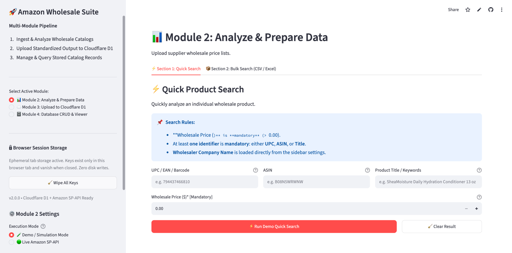
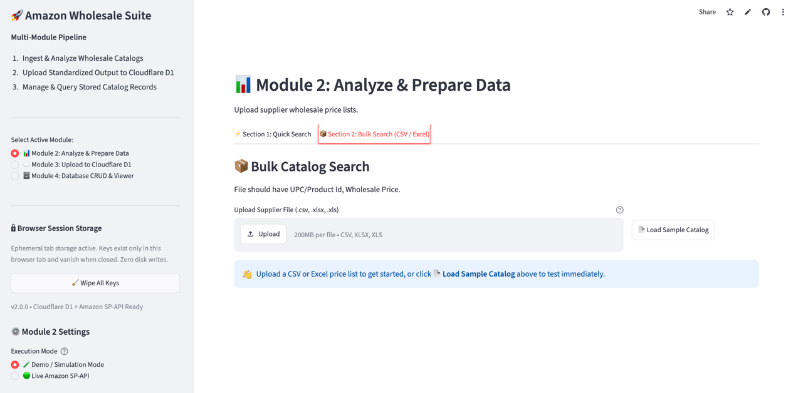
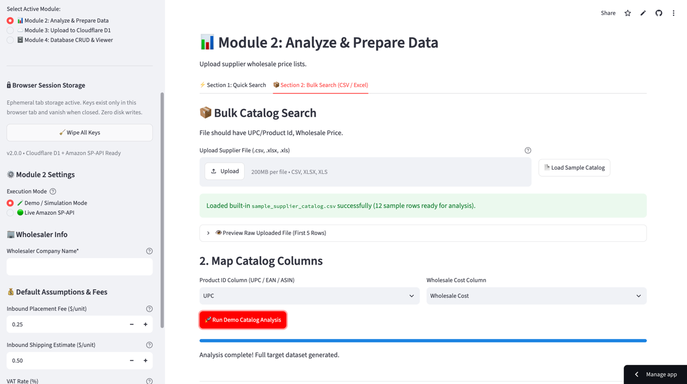
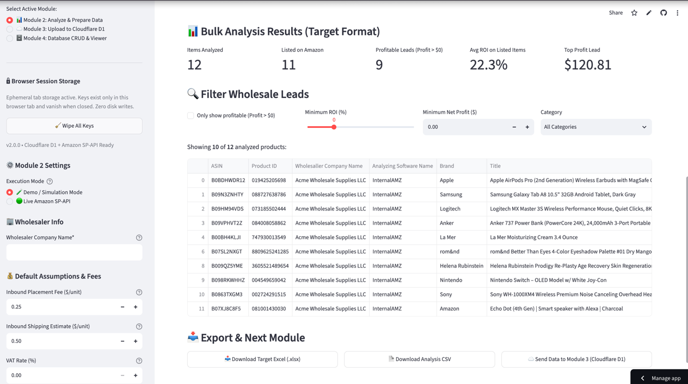
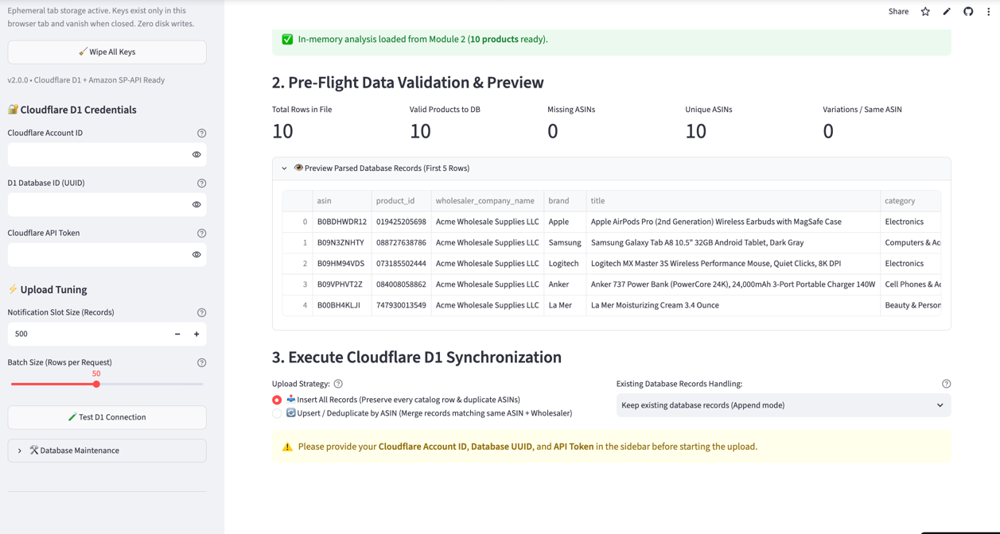
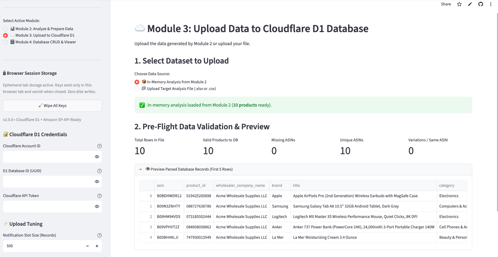
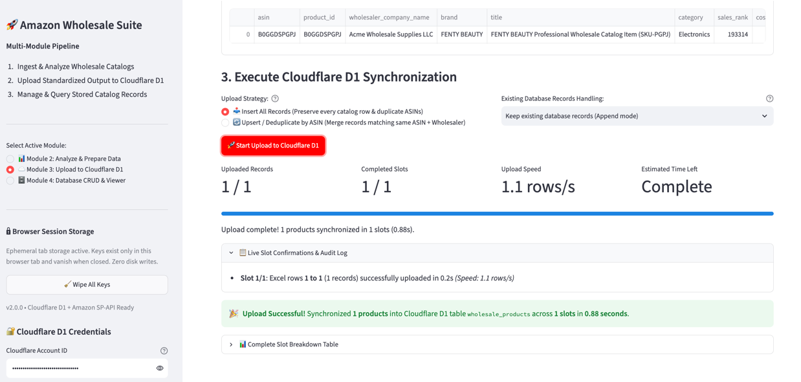
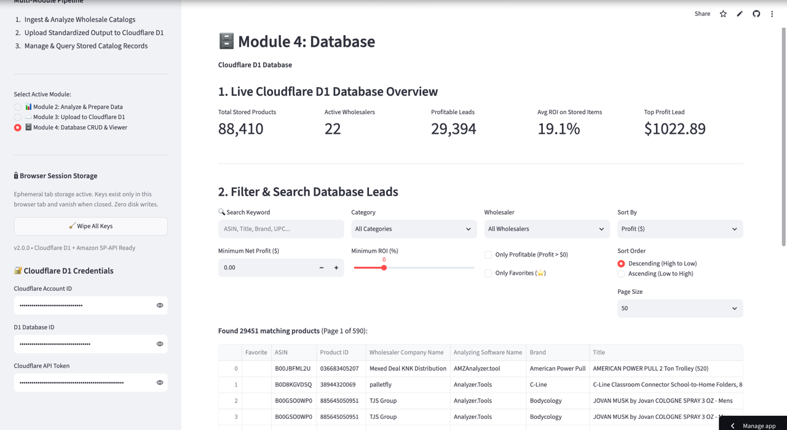

# Amazon Wholesale Suite (`amztools`) 🚀

[](https://www.python.org/)
[](https://streamlit.io/)
[](https://developer-docs.amazon.com/sp-api/)
[](https://developers.cloudflare.com/d1/)
[]()
[](LICENSE)

> A high-performance, enterprise-grade wholesale catalog analysis and unit-economics decision engine for Amazon FBA sellers, backed by Cloudflare D1 edge persistence.


---

## 📌 Features

- **⚡ Dual Execution Modes (Live SP-API & Simulation)**:
  - **Live Amazon SP-API Mode**: Real-time integration with Amazon Selling Partner API (Catalog Items `2022-04-01` & Product Pricing) using Login with Amazon (LWA) credentials across 8 global marketplaces (US, UK, DE, CA, FR, IT, ES, JP).
  - **High-Fidelity Simulation Mode**: Offline evaluation with built-in catalog fixtures and deterministic simulation matching real-world marketplace conditions.
- **📂 Multi-Format Catalog Ingestion**: Supports `.csv`, `.xlsx`, and `.xls`. Preserves leading zeros on barcodes (UPC, EAN, GTIN, ASIN) with smart column auto-detection and mapping.
- **💰 Precision Unit Economics & Fee Engine**:
  - **FBA Pick & Pack Fees**: Automated calculation by weight, volume, standard size tiers, hazmat status, and low-price FBA eligibility ($\le \$10.00$).
  - **Category Referral Fees**: Split percentage tier detection (e.g. Beauty & Personal Care 8%/15% split at \$10.00, Grocery 8%/15% at \$15.00) with a \$0.30 minimum fee floor.
  - **Landed Cost Customization**: Custom inputs for Inbound Placement Fees, Inbound Shipping estimates, and VAT rates.
  - **Automated Profitability Analysis**: Instant calculation of Seller Proceeds, Net Profit (\$), Profit Margin (%), ROI (%), and Break-Even Sell Price.
- **📈 BSR & Sales Velocity Estimation**: Category-calibrated power-law regression model converting Amazon Best Sellers Rank (BSR) into estimated monthly unit sales and revenue.
- **📑 Target 52-Column Excel & CSV Export**: Produces executive-ready `.xlsx` reports conforming to the enterprise **Target 52-Column Wholesale Standard** with corporate navy styling, freeze panes, auto-filters, and fixed 20pt single-line row heights.
- **☁️ Cloudflare D1 Edge Synchronization**: High-speed batch ingestion into Cloudflare D1 (serverless SQLite at the edge) with smart 500-record slot batching, real-time audit logs, progress tracking, and toast notifications.
- **🗄️ Full Database CRUD Operations & Lead Explorer**: Query, filter, edit, delete, and favorite stored leads directly through an interactive Streamlit UI.
- **🔒 Zero-Disk Browser Session Security**: Uses browser `sessionStorage` for temporary API credentials—keys exist only in active browser memory and vanish on tab close.

---

## 🛠️ Tech Stack

| Layer | Technologies |
| :--- | :--- |
| **Language** | Python 3.9+ |
| **User Interface** | Streamlit, Plotly, HTML5/CSS3 Component Bridge |
| **Data Processing** | Pandas, NumPy, OpenPyXL |
| **External APIs** | Amazon Selling Partner API (`python-amazon-sp-api`), Login with Amazon (LWA) |
| **Edge Database** | Cloudflare D1 (Serverless SQLite), Cloudflare REST API v4 |
| **Testing & Tooling** | `unittest`, `pytest`, `flake8`, `black`, PEP 517/518 Packaging |

---

## ⚙️ Getting Started

### Prerequisites
Make sure you have the following installed:
- **Python 3.9+** (Python 3.10+ recommended)
- **Git**

### Installation

1. **Clone the repository**:
   ```bash
   git clone https://github.com/Md-Imtiaz-Hossain/amztools.git
   cd amztools
   ```

2. **Create and activate a virtual environment**:
   ```bash
   # macOS / Linux:
   python3 -m venv .venv
   source .venv/bin/activate

   # Windows:
   python -m venv .venv
   .venv\Scripts\activate
   ```

3. **Install dependencies**:
   ```bash
   pip install -r requirements.txt
   ```

4. **Configure environment variables (Optional)**:
   ```bash
   cp .env.example .env
   # Add your Amazon SP-API and Cloudflare D1 keys (or enter them directly in the UI)
   ```

### Running the Project

Launch the interactive web application via Streamlit:

```bash
streamlit run streamlit_app.py
```

Or via the CLI launcher:

```bash
python main.py
```

The application will open in your browser at `http://localhost:8501`.

---

## 📸 Visual Walkthrough & Module Guide

The application is structured into four decoupled, extensible modules:

### Module 1: Entrypoint & Ephemeral Session Bridge
Provides top-level routing and manages browser `sessionStorage` for secure in-memory credential persistence without writing sensitive API tokens to disk.

---

### Module 2: Analyze & Prepare Data

#### 1. Quick Product Search
Quickly evaluate an individual wholesale item by UPC, EAN, ASIN, or Title with real-time fee calculation.



#### 2. Bulk Catalog Ingestion
Upload supplier manifests in `.csv`, `.xlsx`, or `.xls` format, or click **Load Sample Catalog** to test immediately with 12 verified sample items.



#### 3. Smart Column Auto-Mapping
Intelligently matches supplier columns to required identifier (UPC/EAN/ASIN) and wholesale cost fields.



#### 4. Bulk Analysis Results & Target Excel Export
Review KPI metrics, filter leads by ROI or category, and download the styled **Target 52-Column Excel** report or dispatch results directly to Module 3.



---

### Module 3: Upload Data to Cloudflare D1 Database

#### 1. Credentials Configuration & Tuning
Configure Cloudflare Account ID, Database UUID, and API Token with adjustable batch sizes and slot notification intervals.



#### 2. Pre-Flight Data Validation & Schema Preview
Verifies catalog integrity, checks for missing ASINs, detects multi-pack variations, and previews parsed database records prior to insertion.



#### 3. High-Speed Slot Synchronization & Live Audit Logs
Streams records into Cloudflare D1 with real-time progress indicators, upload velocity metrics, slot confirmations, and instant toast notifications.



---

### Module 4: Cloudflare D1 Database CRUD Operations & Data Viewer

#### Live Database Overview & Lead Explorer
Inspect total stored products, active wholesalers, profitable leads, and average ROI across all catalog uploads. Search, sort, filter, favorite, edit, and delete leads in real time.



---

## 📋 Target 52-Column Specification

The export workbook strictly conforms to the enterprise Target Wholesale standard:

| Category | Key Columns Included |
| :--- | :--- |
| **Identifiers** | `ASIN`, `Parent ASIN`, `Product ID` (UPC/EAN), `Brand`, `Manufacturer`, `Model`, `Part Number` |
| **Listing Status** | `Title`, `Package Quantity`, `Amazon Link`, `Color`, `Is Hazmat`, `Is Top Level Category`, `Last Run` |
| **Eligibility & Gate** | `Brand Restriction`, `Selling Restriction`, `Selling Restriction Link` |
| **Sales & Velocity** | `Sales Rank`, `Sub Category`, `Sub Category Sales Rank`, `Current Est Sales`, `Estimated Monthly Revenue ($)` |
| **Market Pricing** | `Cost`, `Sell Price`, `Buybox Landed`, `Lowest FBA`, `Lowest FBM`, `BuyBox Contention`, `Total Offers`, `New FBA Offers`, `New FBM Offers` |
| **Fulfillment & Fees** | `FBA Pick & Pack Fee ($)`, `Inbound Placement Fee`, `Fulfillment Subtotal`, `Inbound Shipping Estimate`, `Package Dimensions (in)`, `Package Weight (lb)` |
| **Referral & Taxes** | `Referral Fee %`, `Referral Fee`, `VAT %`, `VAT $`, `Cost Subtotal` |
| **Profitability** | `Seller Proceeds`, `Profit ($)`, `Margin (%)`, `ROI (%)`, `Break Even Sell Price` |
| **Product Media** | `Product Image link 1` through `Product Image link 5` |
| **Reviews & Intel** | `Average Rating`, `Total Review Count`, `Customer Reviews`, `About this item`, `Keepa`, `CamelCC`, `Wholesaller Company Name`, `Analyzing Software Name` |

---

## 🏗️ Project Architecture

```
amztools/
├── assets/                          # Static assets and documentation media
│   ├── banner.png                   # Main banner screenshot
│   └── screenshots/                 # Detailed module screenshots
├── data/                            # Sample catalogs and layout references
│   ├── sample_supplier_catalog.csv  # Built-in sample catalog for testing
│   └── Target_Data_and_format.xlsx  # Reference spreadsheet defining 52-column layout
├── docs/                            # Architectural and developer guides
│   └── ARCHITECTURE.md              # Pipeline architecture & extension guidelines
├── modules/                         # Core decoupled application packages
│   ├── __init__.py                  # Multi-module package registry
│   ├── entrypoint/                  # Module 1: Navigation router & session bridge
│   ├── analyzer/                    # Module 2: Ingestion, SP-API, unit economics, Excel export
│   ├── uploader/                    # Module 3: Cloudflare D1 REST client, batch ingestion
│   └── crud/                        # Module 4: Cloudflare D1 SQL query engine & lead manager
├── tests/                           # Automated unit test suite
├── .github/workflows/               # GitHub Actions CI workflow
├── main.py                          # CLI & programmatic launcher
├── streamlit_app.py                 # Streamlit root entrypoint
├── pyproject.toml                   # PEP 517/518 packaging and tooling metadata
├── requirements.txt                 # Runtime dependencies
├── requirements-dev.txt             # Development & testing dependencies
├── .env.example                     # Environment variables template
└── LICENSE                          # MIT License
```

For guidelines on extending modules, adding new Amazon marketplaces, or modifying database schemas, refer to [docs/ARCHITECTURE.md](docs/ARCHITECTURE.md).

---

## 🧪 Testing & Verification

Run the automated test suite covering all modules:

```bash
# Run with Python standard unittest:
python -m unittest discover tests

# Or run with pytest:
pytest
```

Verify that all module packages load cleanly:

```bash
python -c "
from modules.entrypoint import AppRouter
from modules.analyzer import load_supplier_file, calculate_comprehensive_financials, export_to_target_excel
from modules.uploader import CloudflareD1Client, D1UploaderService
from modules.crud import D1CrudService
print('✅ All modules loaded successfully!')
"
```

---

## 🗺️ Roadmap

- [x] Multi-format catalog ingestion (CSV, XLSX, XLS) with leading-zero preservation
- [x] Dual-mode Amazon SP-API live integration & deterministic simulation
- [x] Unit economics fee engine (FBA size tiers, referral splits, low-price FBA)
- [x] Target 52-column styled Excel workbook generator
- [x] Cloudflare D1 REST API client with smart slot batching & live audit logs
- [x] Cloudflare D1 interactive CRUD manager, KPI dashboard & lead explorer
- [x] Ephemeral in-browser `sessionStorage` credential management
- [ ] Keepa interactive chart embedding in lead viewer
- [ ] Multi-currency FX automated conversion (USD, GBP, EUR, CAD, JPY)
- [ ] Automated Buy Box repricing & inventory replenishment alerts

---

## 📄 License

Distributed under the MIT License. See [`LICENSE`](LICENSE) for more information.
